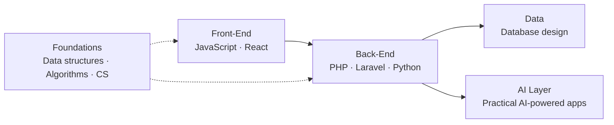

<p align="center">
  
</p>

<h1 align="center">PHEARUN PO</h1>

<p align="center">
  <code>Front-End Developer</code> · <code>Software Engineering Student</code> · <code>AI Enthusiast</code>
</p>

<p align="center">
  Building modern, responsive, user-friendly applications.<br>
  Strengthening engineering fundamentals while exploring full-stack development and AI engineering.
</p>

<p align="center">
  <a href="https://github.com/therealphearunpo">
    
  </a>
</p>

---

## `00 // SPEC SHEET`

| Field | Value |
|---|---|
| **Name** | Phearun Po |
| **Role** | Front-End Developer |
| **Discipline** | Software Engineering (student) |
| **Interests** | Full-stack development · AI engineering |
| **Primary stack** | JavaScript · React |
| **Secondary stack** | Python · PHP · Laravel |
| **Tooling** | Git · GitHub |
| **Status** | `ONLINE` — learning, building, shipping |

---

## `01 // TECH STACK`

<p align="center">
  
  
  
  
  
  
  
</p>

### System layers



---

## `02 // CURRENT FOCUS`

```text
MODULE                                              STATE
────────────────────────────────────────────────────────────
[■■■■■■■■□□] Clean, responsive front-end            ACTIVE
[■■■■■■■□□□] JavaScript & modern web development    ACTIVE
[■■■■■■□□□□] Data structures, algorithms, CS core   ACTIVE
[■■■■□□□□□□] Backend development & database design  EXPLORING
[■■■■□□□□□□] Practical AI-powered applications      EXPLORING
```

> Progress bars are an informal self-assessment, not a measured metric.

---

## `03 // FEATURED PROJECTS`

| ID | Project | Overview | Main technology |
|---|---|---|---|
| `P-01` | [Data Structure Visualizer](https://github.com/therealphearunpo/data-structure-visualizer) | A project focused on visualizing data structures. | JavaScript |
| `P-02` | [Khmer OCR Document Management](https://github.com/therealphearunpo/Khmer-OCR-Document-Management-) | A project focused on Khmer OCR and document management. | Blade |

---

## `04 // ENGINEERING PRINCIPLES`

1. **Build with curiosity.** Start from the question, not the framework.
2. **Learn by doing.** Ship small, iterate, refactor.
3. **Fundamentals first.** Data structures and algorithms underpin everything.
4. **Improve every day.** Small, consistent increments compound.

---

## `05 // GITHUB TELEMETRY`

<p align="center">
  
  
</p>

---

## `06 // CONNECT`

<p align="center">
  <a href="https://github.com/therealphearunpo">
    
  </a>
</p>

<p align="center">
  <code>Build with curiosity. Learn by doing. Improve every day.</code>
</p>
