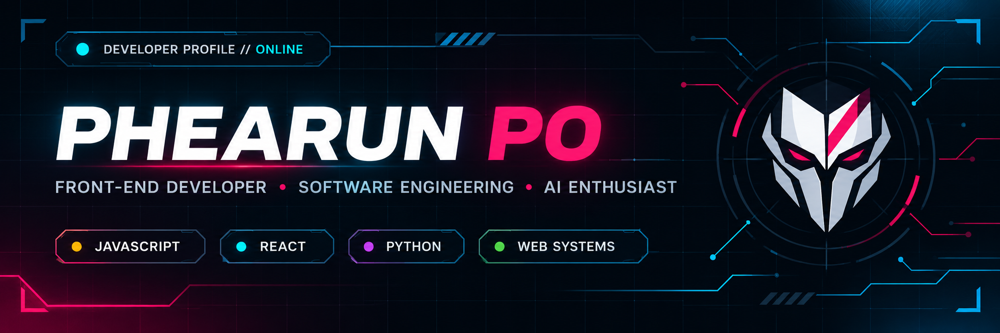

<h1 align="center">Phearun Po</h1>

<p align="center">
  
</p>

<p align="center">
  
</p>

<p align="center">
  <a href="https://github.com/therealphearunpo">
    
  </a>
  
</p>

```bash
$ whoami
phearun-po

$ cat /etc/motto
learn | design | build | evaluate | improve
```

---

## 01 / Engineering Profile

```yaml
education:
  university: Royal University of Phnom Penh
  major: Information Technology Engineering
  year: 3

interests:
  - Artificial Intelligence
  - Software Engineering
  - Intelligent Systems
```

---

## 02 / Technology Stack

```python
stack = {
    "programming": ["Python", "C", "C++", "Java", "JavaScript", "PHP"],
    "ai_ml":       ["PyTorch", "TensorFlow", "Scikit-learn"],
    "web":         ["React", "Node.js", "Laravel", "HTML", "CSS"],
    "data_infra":  ["MySQL", "PostgreSQL", "Docker", "Linux", "Git", "AWS"],
}
```

<p align="center">
  
</p>

---

## 03 / Current Focus

```python
focus = [
    "Machine Learning",
    "Natural Language Processing",
    "Generative AI & LLMs",
    "Retrieval-Augmented Generation",
    "Full-Stack Development",
    "System Design",
]
```

---

## 04 / GitHub Analytics

<p align="center">
  <picture>
    <source media="(prefers-color-scheme: dark)" srcset="https://github-readme-stats.vercel.app/api?username=therealphearunpo&amp;show_icons=true&amp;theme=github_dark&amp;hide_border=true">
    
  </picture>
</p>

<p align="center">
  <picture>
    <source media="(prefers-color-scheme: dark)" srcset="https://streak-stats.demolab.com/?user=therealphearunpo&amp;theme=github_dark&amp;hide_border=true">
    
  </picture>
</p>

---

<p align="center">
  <sub>BUILDING INTELLIGENT SYSTEMS.</sub>
</p>
